<div align="center">
  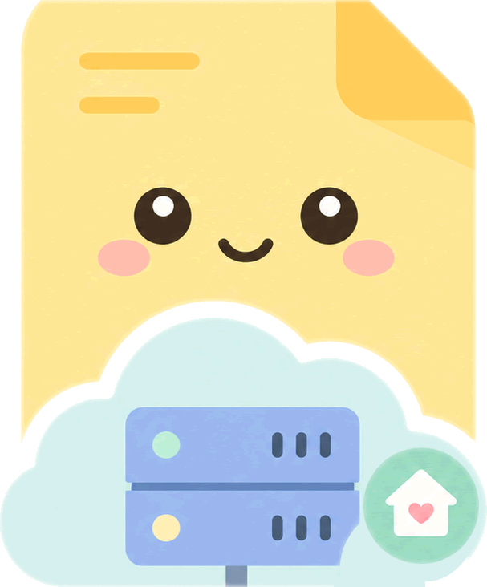
  <br>
  

# Kept

### Google Keep-style notes, on your device, your server, or Kept Cloud

</div>

<p align="center">
  Kept is an open-source notes app for the web, iOS and Android. Fast, colourful, offline-first, and designed to stay simple.
</p>

<p align="center">
  <a href="https://apps.apple.com/ca/app/kept-notes/id6768974473">
    
  </a>
  <a href="https://play.google.com/store/apps/details?id=xyz.keepitkept.app">
    
  </a>
  <a href="https://ko-fi.com/kept_notes">
    
  </a>
</p>

<p align="center">
  <a href="https://cloud.keepitkept.xyz/">
    
  </a>
</p>

<p align="center">
  <a href="#self-hosting">Self-host Kept</a> ·
  <a href="#technical-documentation">Technical documentation</a>
</p>

## Kept on the web

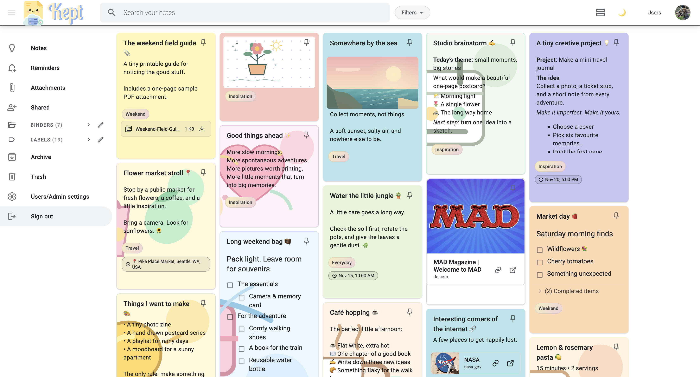

## Use Kept your way

### Your own server

Run Kept with Docker and keep control of your data. Access your notes in a browser or sync with the native mobile apps.

### Kept Cloud

Add sync, backups, collaboration and web access without maintaining your own infrastructure.

### On your device

Keep notes on your device with no account or server. Use the native app offline, back up your notes, or move them to a server later.

## Notes in action

<table>
  <tr>
    <td width="50%" valign="top">
      <strong>Drawings</strong><br>
      Sketch directly in a note, with pens, a highlighter and a choice of paper backgrounds.
      <p>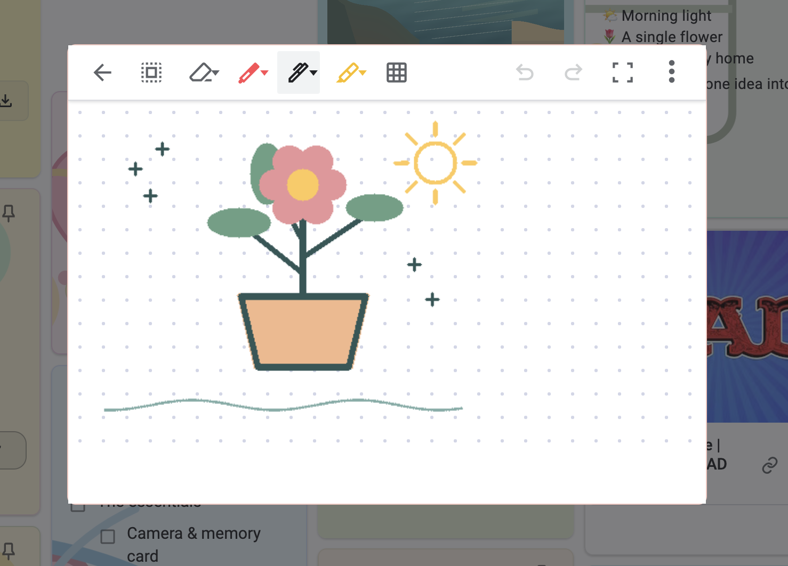</p>
    </td>
    <td width="50%" valign="top">
      <strong>Nested checklists</strong><br>
      Group items, drag to reorder, and tuck completed items away.
      <p>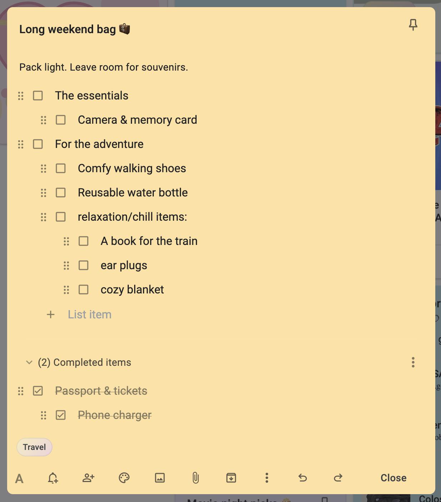</p>
    </td>
  </tr>
</table>

## More than basic notes

- Text and rich notes
- Rich hyperlinks - copy and paste just a URL and a pretty whole-card preview will get created
- Nested checklists with drag-to-reorder
- Images, drawings, links and file attachments
- Labels, binders, colours and backgrounds
- Customisable appearance, note density, checklist behaviour and shared-note organization
- Time-based (one-off or recurring) and location-based reminders.
- Native iOS and Android widgets
- Native sharing - share links, photos, files to kept on iOS or Android and they will automatically make a note with that captured
- Real-time collaboration and shared binders
- Offline-first sync
- Google Keep Takeout import
- Full backup and restore
- Automated scheduled database backups
- OIDC / SSO
- OAuth 2.1
- Local and remote MCP access
- On-device Smart Capture on supported phones

<details>
<summary>See recurring reminders and rich link previews</summary>

<table>
  <tr>
    <td width="50%" valign="top">
      <strong>Reminders that fit your routine</strong><br>
      Set a time, choose a repeat schedule, and have the note float to the top when it fires.
      <p>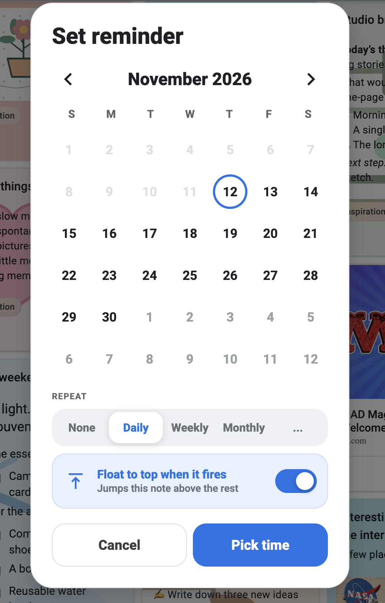</p>
    </td>
    <td width="50%" valign="top">
      <strong>Links worth keeping</strong><br>
      Paste URLs into a note to see rich previews alongside your text.
      <p>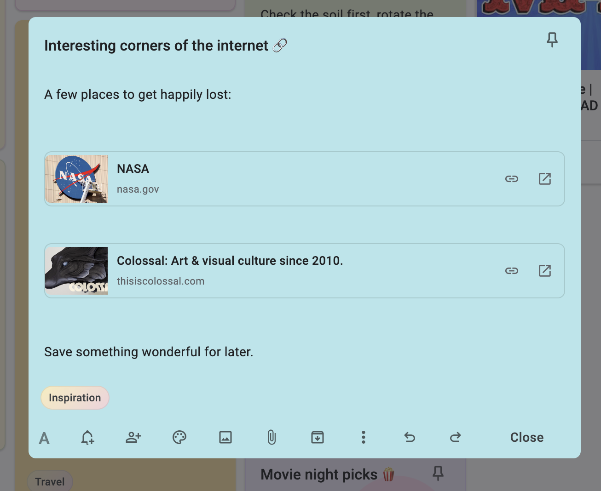</p>
    </td>
  </tr>
</table>

</details>

<details>
<summary>Customise Kept's appearance and editing behaviour</summary>

Adjust the theme, note density, checklist behaviour, link previews, and how shared notes use labels and binders.

<p align="center">
  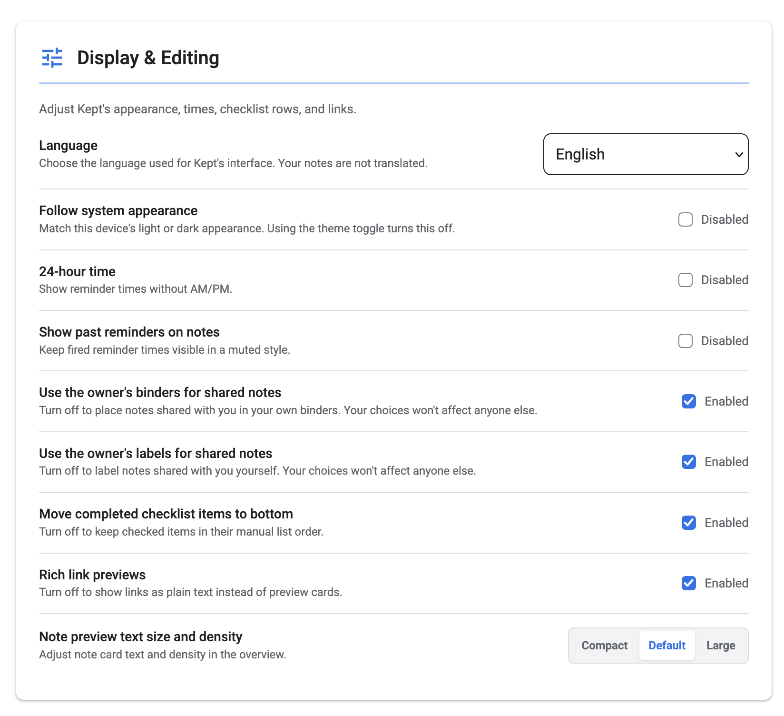
</p>

</details>

## Capture from anywhere

Share links, photos, text and files into Kept from other apps. On iOS and Android, Home Screen widgets let you browse notes, tick off checklist items and quickly capture something new.

## Open source, by design

Built in the open, with the immediacy of Google Keep and control over where your notes live.

---

# Technical documentation

## Use Kept Locally Without a Server

With the native iOS and Android apps, you can start using Kept without Docker, a server, or a Kept account:

1. Install the native app using the App Store or Google Play links above.
2. Choose **Use on this device** on the welcome screen.
3. Create and organize your notes offline.

Device-only mode keeps your notes, checklists, images, drawings, attachments, labels, and reminders on the device. Sharing, collaboration, web access, access across devices, and server integrations still require a Kept server.

In **Settings → Notes on this device**, use **Save a complete backup** to save your library, or **Restore a backup** to restore it on an iOS or Android device. Save backups somewhere outside the app: deleting the app or losing the device can mean losing its local notes.

If you decide to sync across devices later, choose **Move my notes to a server** in the same section, then choose Kept Cloud or your own server. This transfers your entire local library, including images and attachments.


<a id="self-hosting"></a>

## Install a Server With Docker

Requirements:

- Docker with Compose
- Git

Kept's recommended install path is to use the published Docker image: `ghcr.io/ericerkz/kept:latest`.

```bash
git clone https://github.com/ericerkz/kept.git
cd kept
docker compose up -d
```

Open `http://localhost:6767` and create the first admin account.

Kept stores its database, uploads, attachments, and generated server data in `./data`. Back that folder up if you are not using the built-in backup tools.

## Kept Cloud — Hosting Handled for You

Want web access, sharing, and sync across devices without setting up Docker or managing a server? Kept Cloud runs and maintains your own private Kept server for you.

[](https://cloud.keepitkept.xyz/)

- Hosting, automatic backups, and updates are handled for you.
- Use Kept on iOS, Android, and the web at your own server address.
- Add family, friends, or teammates. Everyone shares one subscription, with no per-user charge.
- Use the same Kept features available when self-hosting.

Visit [Kept Cloud](https://cloud.keepitkept.xyz/) to create your account and set up your server. Once it's ready, open your server address in a browser or connect the native mobile apps.

Kept remains free to self-host on any platform that supports Docker. Device-only mode in the native apps also works without a server or subscription.

## Native iOS App

[Kept Notes is available on the App Store](https://apps.apple.com/ca/app/kept-notes/id6768974473). Use it on your iPhone or iPad without a server, or connect to Kept Cloud or your own Kept server:

- Device-only notes, complete backups and restore, and offline editing with automatic sync when connected to a server.
- Apple Reminders support.
- Location reminders with arrival/departure settings, and the ability to save locations
- Quick share into Kept from the iOS share sheet.
- On-device Smart Capture using Apple Intelligence.
- Move device-only notes to a Kept server later.

<p align="center">
  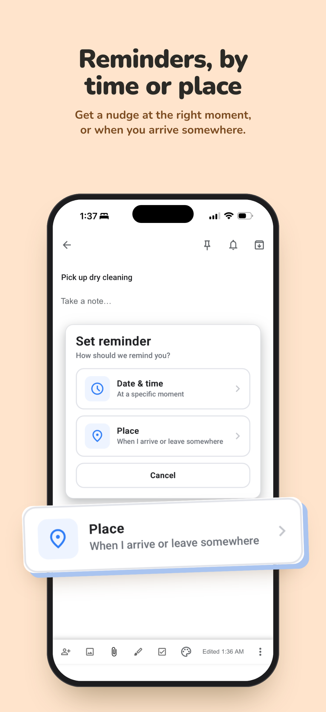
  &nbsp;&nbsp;
  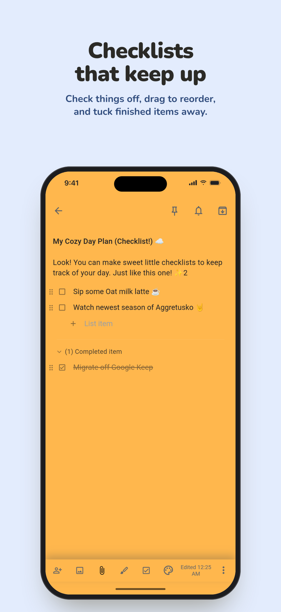
</p>

## Native Android App

[Kept Notes is available on Google Play](https://play.google.com/store/apps/details?id=xyz.keepitkept.app). Use it without a server, or connect to Kept Cloud or your own Kept server:

- Device-only notes, complete backups and restore, and offline editing with automatic sync when connected to a server.
- Location reminders with arrival/departure settings, background geofencing, and saved places.
- Quick share into Kept from the Android share sheet.
- Home screen widgets for recent notes, pinned notes, filtered labels/binders, quick note creation, and a single selected note.
- On-device Smart Capture using Android's native Gemini Nano when available, or Kept's local Gemma fallback model on Android devices that need it.
- Move device-only notes to a Kept server later.

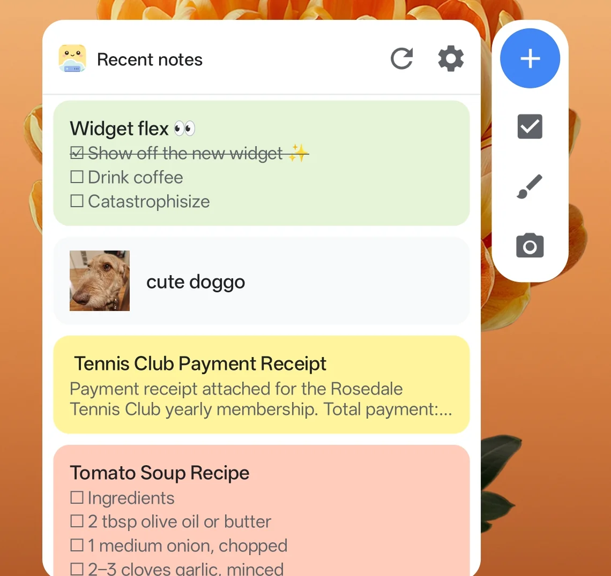

*Browse recent notes and capture something new from your Android home screen.*

## PWA / Mobile Browser

The Kept web app can also be installed as a PWA on iOS and Android. PWA use requires a Kept server; device-only mode is available in the native apps. For push notifications and reliable mobile installs, serve Kept from a secure `https://` URL. Location-based reminders require the native iOS or Android app.

The short setup guide is on the [Kept website](https://www.keepitkept.xyz/#pwa-mobile).

## Reverse Proxy / HTTPS

Use HTTPS if you want public access, PWA installs, OAuth redirects, or push notifications. Point your proxy at `127.0.0.1:6767`.

Realtime presence and collaborative editing use WebSockets at `/api/realtime`, so proxy that path with WebSocket upgrade support.

Apache example:

```apache
# Required once:
# sudo a2enmod proxy proxy_http proxy_wstunnel rewrite ssl
# sudo systemctl reload apache2

<VirtualHost *:80>
    ServerName kept.example.com
    Redirect permanent / https://kept.example.com/
</VirtualHost>

<IfModule mod_ssl.c>
<VirtualHost *:443>
    ServerName kept.example.com
    ProxyRequests Off
    ProxyPreserveHost On

    ProxyPass /api/realtime ws://127.0.0.1:6767/api/realtime
    ProxyPassReverse /api/realtime ws://127.0.0.1:6767/api/realtime

    ProxyPass / http://127.0.0.1:6767/
    ProxyPassReverse / http://127.0.0.1:6767/

    SSLEngine on
    SSLCertificateFile /etc/letsencrypt/live/kept.example.com/fullchain.pem
    SSLCertificateKeyFile /etc/letsencrypt/live/kept.example.com/privkey.pem
</VirtualHost>
</IfModule>
```

Nginx example:

```nginx
server {
    listen 80;
    server_name kept.example.com;
    return 301 https://$host$request_uri;
}

server {
    listen 443 ssl http2;
    server_name kept.example.com;

    ssl_certificate /etc/letsencrypt/live/kept.example.com/fullchain.pem;
    ssl_certificate_key /etc/letsencrypt/live/kept.example.com/privkey.pem;

    location /api/realtime {
        proxy_pass http://127.0.0.1:6767/api/realtime;
        proxy_http_version 1.1;
        proxy_set_header Upgrade $http_upgrade;
        proxy_set_header Connection "upgrade";
        proxy_set_header Host $host;
        proxy_set_header X-Forwarded-For $proxy_add_x_forwarded_for;
        proxy_set_header X-Forwarded-Proto $scheme;
    }

    location / {
        proxy_pass http://127.0.0.1:6767;
        proxy_set_header Host $host;
        proxy_set_header X-Forwarded-For $proxy_add_x_forwarded_for;
        proxy_set_header X-Forwarded-Proto $scheme;
    }
}
```

### Advanced config

#### VPN/Tailscale/WireGuard setups

If you access Kept through Tailscale, WireGuard, another VPN, a LAN hostname/IP, or more than one reverse-proxy domain, the CORS settings may be relevant. These setups do not require special CORS settings by themselves; CORS only matters when the browser page and Kept API are reached through different origins, or when you restrict origins with `KEPT_CORS_ORIGINS`. If you use `KEPT_CORS_ORIGINS`, include each exact browser origin you use, such as your Tailnet name, VPN-only domain, LAN IP, or public reverse-proxy domain, including the scheme and port when applicable. Same-origin access does not need extra CORS configuration. Browser sessions use HttpOnly cookies: a separate SPA origin requires an explicit `KEPT_CORS_ORIGINS` allowlist and must be on the same site as the API. `KEPT_CORS_ALLOW_ALL=1` supports bearer-authenticated native/API clients; it cannot authorize cross-origin browser cookies. See the [1.8.2 release notes](docs/releases/1.8.2.md#updating) for upgrade details.

#### Custom header support in the mobile apps

The native iOS and Android app origins are allowed automatically when neither CORS option is configured. You do not need `KEPT_CORS_ALLOW_ALL=1` just to connect the mobile apps. This default allows exact app origins without cross-origin cookie credentials; API authentication is still required. Explicit CORS allowlists and wildcard mode continue to work as configured.

The native iOS and Android apps support optional custom connection headers for reverse proxies or access gateways that require them, such as Cloudflare Access service tokens or shared-secret proxy headers. Configure these only if your proxy setup requires them.

Custom headers help the mobile apps pass normal Kept HTTP requests through a header-auth gateway, including login, loading notes, saving notes, attachments, and settings. They are not a replacement for Kept login; users still need a Kept account/session.

Custom headers do not apply to realtime WebSocket connections. Realtime presence and live collaboration use WebSockets at `/api/realtime`, and browser/WebView WebSockets cannot attach arbitrary custom headers. Behind gateways that require header auth on WebSocket upgrade requests, normal reads/writes should still work, but live updates may only appear after refocusing the app or manually refreshing.

#### OpenID Connect single sign-on

Kept can use an OpenID Connect provider for optional single sign-on. Username/password login stays available by default. Set `BASE_URL`, `KEPT_OIDC_ISSUER`, and `KEPT_OIDC_CLIENT_ID`; confidential clients should also set `KEPT_OIDC_CLIENT_SECRET`. Existing users can choose **Connect SSO account** in Settings. If self-registration is enabled, new users can sign in with the provider and finish creating their Kept account, subject to the existing approval setting. Kept never links accounts by matching email addresses.

After linking and testing SSO for your existing users, including an administrator, you can require SSO with `KEPT_DISABLE_PASSWORD_LOGIN=1`. New users can still register through OIDC when self-registration is enabled; email invitations are paused. See the [OIDC setup guide](docs/oidc.md#require-single-sign-on) for setup and recovery instructions.

The callback URL to register with your identity provider is `https://your-kept.example/api/auth/oidc/callback`. OIDC sign-in is an additional authentication path, not a replacement for Kept's own authorization rules. See the [OIDC setup guide](docs/oidc.md) for configuration and account-linking details.


## Backups And Restore

For device-only notes, use **Settings → Notes on this device → Save a complete backup** in the native app. The backup includes notes, images, attachments, reminders, and device preferences. Use **Restore a backup** in either native app to restore that library on a device. Backup reminders are optional in-app prompts; they do not create backups automatically.

For servers, admins can choose **User management → Download a full backup** to save a ZIP containing a consistent SQLite snapshot, uploaded images, attachments, and web-push keys for all accounts. This is a server-wide backup containing private data for every user; store it somewhere private. Server environment variables and reverse-proxy configuration must be configured separately on the destination. If you supply VAPID keys through environment variables, configure those consistently on the destination too.

Scheduled daily, weekly, or monthly backups remain database-only SQLite snapshots. The readable JSON/CSV/Markdown exports in Settings are per-user exports, exclude media files, and cannot be imported back into Kept.

<details>
<summary>See automated backup settings</summary>

<p align="center">
  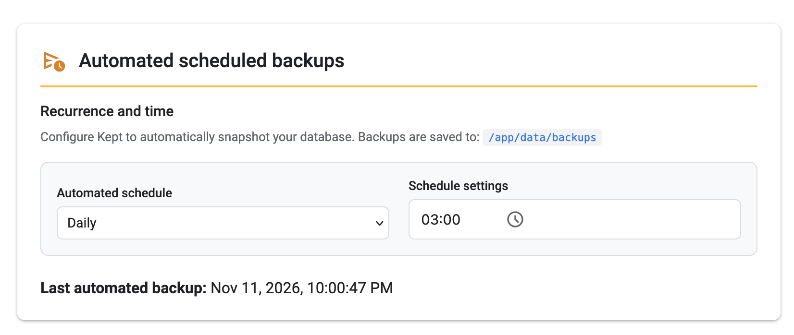
</p>

</details>

To restore from a backup during setup:

1. Set `KEPT_ALLOW_RESTORE=1`.
2. Restart Kept.
3. Before creating any accounts, upload the full server ZIP or an older `.sqlite` backup from the setup screen. Full ZIP backups restore images and attachments too; SQLite-only backups do not include those files. Device-only mobile backups use a different format and must be restored in a native app.
4. Remove `KEPT_ALLOW_RESTORE` and restart again.

The restore flag is intentionally opt-in so the restore endpoint is not left open on a public instance. Restore uploads and their expanded contents are limited to 20 GB by default; set `KEPT_BACKUP_UPLOAD_MAX` (for example, `40GB`) if necessary, and allow sufficient temporary disk space. A reverse proxy may impose a lower upload limit.

## Updating

```bash
cd kept
docker compose pull
docker compose up -d
```

Your `./data` folder is not replaced by updates.

## Configuration

Useful environment variables are documented in `docker-compose.yml`. The common ones are:

- `BASE_URL`: public origin used for OAuth/callback generation. Required for remote MCP/OAuth and OIDC.
- `KEPT_OIDC_ISSUER` / `KEPT_OIDC_CLIENT_ID` / `KEPT_OIDC_CLIENT_SECRET`: optional upstream OIDC single sign-on provider.
- `KEPT_OIDC_NAME`: label shown on the sign-in button. Defaults to `Single sign-on`.
- `KEPT_OIDC_SCOPES`: scopes requested from the provider. Defaults to `openid profile email`.
- `KEPT_DISABLE_PASSWORD_LOGIN`: set to `1` to require configured OIDC sign-in after linking an enabled administrator and your users. Off by default.
- `KEPT_SESSION_TTL_DAYS`: login session lifetime. Defaults to 30 days.
- `KEPT_CORS_ALLOW_ALL` / `KEPT_CORS_ORIGINS`: CORS behavior for remote clients and native shells. Native app WebView origins are allowed automatically when using `KEPT_CORS_ORIGINS`.
- `KEPT_CALDAV_ALLOWED_PRIVATE_ORIGINS`: optional comma-separated origins for trusted CalDAV services on private networks, for example `http://calendar:5232,https://calendar.home:8443`.
- `KEPT_PUSH_ALLOWED_PRIVATE_ORIGINS`: optional comma-separated HTTPS origins for custom private web-push services. Standard browser push providers need no exception.
- `KEPT_TAKEOUT_UPLOAD_MAX`: Google Takeout ZIP upload cap. Defaults to `5GB`; only affects Takeout imports.
- `PUID` / `PGID`: run the container as a specific Linux user/group.
- `KEPT_ALLOW_RESTORE`: temporarily enables restore from backup during setup.
- `VAPID_SUBJECT`: optional public URL/contact identity for web push. Kept auto-generates VAPID keys if you do not set them; only set this if push notifications need a more explicit public origin.

CalDAV and web-push delivery block private, loopback, link-local, and reserved destinations by default, including for previously saved integrations. If your calendar or custom push service is internal, add only its exact origin (scheme, hostname/IP, and port) to the corresponding setting above and restart Kept. Paths, wildcards, and credentials are not accepted in these settings. An exception lets accounts on the instance reach that service; only list services you trust. CalDAV supports HTTP and HTTPS; push delivery requires HTTPS, and HTTPS certificate checks remain enabled. Use the final CalDAV URL, since redirects are not followed.

These settings govern outgoing integration requests, not the address used to access Kept. They do not require an HTTP/LAN Kept installation to change its own URL or reverse-proxy setup.

### Docker secrets

Secret values can come from mounted files instead of environment variables. For example, add this to your Compose configuration:

```yaml
services:
  kept:
    environment:
      KEPT_OIDC_CLIENT_SECRET_FILE: /run/secrets/oidc_client_secret
    secrets:
      - oidc_client_secret

secrets:
  oidc_client_secret:
    file: ./secrets/oidc_client_secret.txt
```

Put the secret value in that file and keep it out of version control. This example shows only the additions; keep your existing image, ports, volumes, and other settings. If your existing `environment` uses list syntax, add `- KEPT_OIDC_CLIENT_SECRET_FILE=/run/secrets/oidc_client_secret` there instead.

The `_FILE` alternative is supported for `KEPT_OIDC_CLIENT_SECRET`, `KEPT_SMTP_USER`, `KEPT_SMTP_PASS`, `KEPT_SETUP_TOKEN`, `KEPT_METRICS_TOKEN`, `VAPID_PUBLIC_KEY`, and `VAPID_PRIVATE_KEY`. Existing direct variables continue to work. Set only one source per value; an empty direct variable is treated as unset.

Files are read once at startup and must be readable by the runtime user configured through `PUID`/`PGID`. Kept removes trailing line endings while preserving spaces. Missing, unreadable, empty, invalid UTF-8, oversized (over 64 KiB), or conflicting secrets stop startup with an error naming the setting, without printing the value. Restart Kept after replacing a secret. The example's `secrets/` directory is excluded from Git and Docker builds; if you use another location, keep it out of version control and the Docker build context too.

### Inviting users by email (optional)

Admins can always create accounts directly from User Management. If you'd rather send someone a link they set their own username/password from, configure an SMTP relay and an admin can turn on "Invite by email" in User Management — the option is hidden entirely until SMTP is configured, and off by default even then.

- `KEPT_SMTP_HOST`: SMTP server hostname. Leaving this unset disables invite-by-email entirely; no UI for it appears anywhere.
- `KEPT_SMTP_PORT`: SMTP port. Defaults to `587`.
- `KEPT_SMTP_SECURE`: set to `1` for implicit TLS (typically port `465`). Defaults to STARTTLS.
- `KEPT_SMTP_USER` / `KEPT_SMTP_PASS`: optional SMTP credentials.
- `KEPT_SMTP_FROM`: the `From` address on invite emails. Defaults to `Kept <no-reply@example.com>`.

This works with any SMTP relay — a personal email account's SMTP, or any transactional-email provider's free tier — nothing here is tied to a specific vendor.

## OAuth, MCP, And External Access

Kept includes an optional OAuth 2.1 authorization server for third-party apps and integrations. OAuth clients can request read-only or read/write access to the supported Kept API without receiving a user's password or long-lived local MCP token. See [the OAuth integration guide](docs/oauth.md).

Remote MCP is one consumer of that OAuth layer. Local MCP clients can use stdio with a dedicated token; remote clients such as ChatGPT can connect to the Streamable HTTP endpoint at `/mcp`. OAuth app access and local MCP access are independent, off-by-default settings, so either can be enabled or revoked without affecting the other. Locked notes and permanent deletion have separate shared opt-in controls. See [the MCP setup and security guide](docs/mcp.md).

## Development

Kept is an Angular app with a Node/Express backend and SQLite storage.

```bash
npm install
npm run start
```

Useful scripts:

- `npm run build`
- `npm run test:sync`
- `npm run test:proxy-image`
- `npm run test:proxy-image:browser` (run `npx playwright install chromium` once first)
- `npm run api`
- `npm run client`

## Translations

Help translate Kept’s web/in-app UI and native Android/iOS screens together in this repository. See the [translation contribution guide](translations/README.md). English is currently the only shipped language.

## Build It Yourself

If you want to build from the local source instead of pulling the published image, use the dev compose override:

```bash
git clone https://github.com/ericerkz/kept.git
cd kept
docker compose -f docker-compose.yml -f docker-compose.dev.yml up -d --build
```

## Acknowledgement

Kept's original UI scaffolding was forked from [aBrihoum/google-keep-clone](https://github.com/aBrihoum/google-keep-clone). The project has since been substantially rewritten and extended into a full self-hosted notes platform — but the visual foundation came from that earlier work, and the credit is gratefully due.
