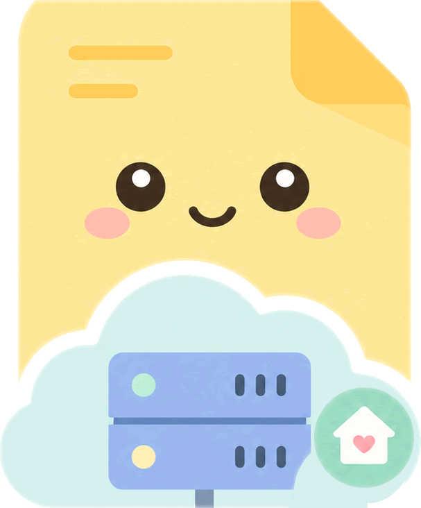
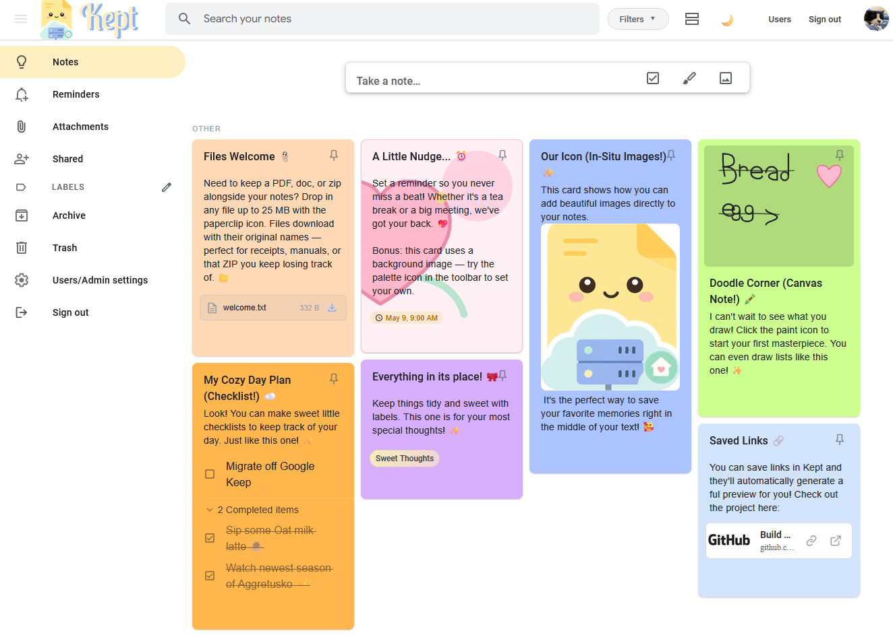

<div align="center">
  
  <br>
  

# Kept

### Google Keep-style notes, on your device or your server

</div>

Kept is a notes app built for quick capture: text notes, checklists, images, drawings, links, attachments, labels, colors, and reminders. Use the native iOS or Android app entirely on your device without setting up a server, or connect to your own Kept server for web access, sharing, and access across devices.

<p>
  <a href="https://apps.apple.com/ca/app/kept-notes/id6768974473">
    
  </a>
  <a href="https://play.google.com/store/apps/details?id=xyz.keepitkept.app">
    
  </a>
  <a href="https://ko-fi.com/kept_notes">
    
  </a>
</p>

<p>
  <a href="https://railway.com/deploy/kept-notes">
    
  </a>
</p>

## Screenshot



## Why Kept Exists

I wanted something that felt like Google Keep: fast, colorful, easy to glance at, and never too heavy for a quick thought. Most self-hosted notes apps I tried were either powerful but fiddly, or simple but missing the feel I wanted. Kept is my attempt at replicating the simplicity of Google Keep, while keeping the data on a server you control.

## Features

- Text notes, checklists, image notes, drawings, links, and file attachments.
- Drag-and-drop note ordering and checklist item ordering.
- Labels, binders, colors, background images, pinned notes, archive, and trash.
- Search and filters, including note type, labels, and date-style queries.
- Link previews and inline images.
- Time reminders with browser push notifications.
- Location-based reminders through the native iOS and Android apps.
- Quick share to Kept from the native iOS and Android share sheets.
- Android home screen widgets for recent notes, pinned notes, specific labels/binders, quick note creation, and a single selected note.
- Real-time collaborative sharing of notes between users on the same instance.
- Device-only mode in the native iOS and Android apps, with no server or account required.
- Offline viewing/editing of downloaded notes in server mode, with automatic sync when the server is reachable again.
- Complete device backups, restore on another mobile device, and a local-to-server transfer when you want to self-host.
- Google Keep Takeout data import.
- Built-in database backups and restore flow.
- Local user accounts, optional 2FA, and user management.
- Local and remote MCP server options for authenticated agent access without direct database access.
- OAuth 2.1 access for scoped third-party API integrations and remote MCP clients.
- Optional OpenID Connect (OIDC) single sign-on alongside Kept's local accounts.
- Device-only notes on iOS and Android or Server-connected for syncing across devices - the choice is yours.

## Use Kept Locally Without a Server

With the 1.9 native iOS and Android apps, you can start using Kept without Docker, a server, or a Kept account:

1. Install the native app using the App Store or Google Play links above.
2. Choose **Use on this device** on the welcome screen.
3. Create and organize your notes offline.

Device-only mode keeps your notes, checklists, images, drawings, attachments, labels, and reminders on the device. Sharing, collaboration, web access, access across devices, and server integrations still require a Kept server.

In **Settings → Notes on this device**, use **Save a complete backup** to save your library, or **Restore a backup** to restore it on an iOS or Android device. Save backups somewhere outside the app: deleting the app or losing the device can mean losing its local notes.

If you decide to self-host later, choose **Move my notes to a server** in the same section. This seamlessly transfers your entire local library to your Kept server, including images and attachments.


## Install a Server With Docker

Requirements:

- Docker with Compose
- Git

Kept's recommended install path is to use the published Docker image: `ghcr.io/ericerkz/kept:latest`.

```bash
git clone https://github.com/ericerkz/kept.git
cd kept
docker compose up -d
```

Open `http://localhost:6767` and create the first admin account.

Kept stores its database, uploads, attachments, and generated server data in `./data`. Back that folder up if you are not using the built-in backup tools.

## Easy Hosted Setup

If you want web access, sharing, or access across devices without setting up Docker or managing a server yourself, Railway can create a ready-to-use Kept instance for you in a few clicks. For mobile use on a single device, you can use device-only mode without a server instead.

[](https://railway.com/deploy/kept-notes)

Railway handles the technical setup:

- Runs Kept for you
- Keeps storage attached for your notes and attachments
- Sets the required configuration
- Gives you a public HTTPS link to open in your browser

Once deployment finishes, open the link Railway gives you and create your first Kept account.

Railway is one convenient way to deploy Kept quickly. Kept remains self-hostable on any platform that supports Docker.

## Native iOS App

[Kept Notes is available on the App Store](https://apps.apple.com/ca/app/kept-notes/id6768974473). Use it on your iPhone or iPad without a server, or connect to your self-hosted Kept server:

- Device-only notes, complete backups and restore, and offline editing with automatic sync when connected to a server.
- Apple Reminders support.
- Location reminders with arrival/departure settings, and the ability to save locations
- Quick share into Kept from the iOS share sheet.
- On-device Smart Capture using Apple Intelligence.
- Move device-only notes to a Kept server later.

## Native Android App

[Kept Notes is available on Google Play](https://play.google.com/store/apps/details?id=xyz.keepitkept.app). Use it without a server, or connect to your self-hosted Kept server:

- Device-only notes, complete backups and restore, and offline editing with automatic sync when connected to a server.
- Location reminders with arrival/departure settings, background geofencing, and saved places.
- Quick share into Kept from the Android share sheet.
- Home screen widgets for recent notes, pinned notes, filtered labels/binders, quick note creation, and a single selected note.
- On-device Smart Capture using Android's native Gemini Nano when available, or Kept's local Gemma fallback model on Android devices that need it.
- Move device-only notes to a Kept server later.

## PWA / Mobile Browser

The Kept web app can also be installed as a PWA on iOS and Android. PWA use requires a Kept server; device-only mode is available in the native apps. For push notifications and reliable mobile installs, serve Kept from a secure `https://` URL. Location-based reminders require the native iOS or Android app.

The short setup guide is on the [Kept website](https://www.keepitkept.xyz/#pwa-mobile).

## Reverse Proxy / HTTPS

Use HTTPS if you want public access, PWA installs, OAuth redirects, or push notifications. Point your proxy at `127.0.0.1:6767`.

Realtime presence and collaborative editing use WebSockets at `/api/realtime`, so proxy that path with WebSocket upgrade support.

Apache example:

```apache
# Required once:
# sudo a2enmod proxy proxy_http proxy_wstunnel rewrite ssl
# sudo systemctl reload apache2

<VirtualHost *:80>
    ServerName kept.example.com
    Redirect permanent / https://kept.example.com/
</VirtualHost>

<IfModule mod_ssl.c>
<VirtualHost *:443>
    ServerName kept.example.com
    ProxyRequests Off
    ProxyPreserveHost On

    ProxyPass /api/realtime ws://127.0.0.1:6767/api/realtime
    ProxyPassReverse /api/realtime ws://127.0.0.1:6767/api/realtime

    ProxyPass / http://127.0.0.1:6767/
    ProxyPassReverse / http://127.0.0.1:6767/

    SSLEngine on
    SSLCertificateFile /etc/letsencrypt/live/kept.example.com/fullchain.pem
    SSLCertificateKeyFile /etc/letsencrypt/live/kept.example.com/privkey.pem
</VirtualHost>
</IfModule>
```

Nginx example:

```nginx
server {
    listen 80;
    server_name kept.example.com;
    return 301 https://$host$request_uri;
}

server {
    listen 443 ssl http2;
    server_name kept.example.com;

    ssl_certificate /etc/letsencrypt/live/kept.example.com/fullchain.pem;
    ssl_certificate_key /etc/letsencrypt/live/kept.example.com/privkey.pem;

    location /api/realtime {
        proxy_pass http://127.0.0.1:6767/api/realtime;
        proxy_http_version 1.1;
        proxy_set_header Upgrade $http_upgrade;
        proxy_set_header Connection "upgrade";
        proxy_set_header Host $host;
        proxy_set_header X-Forwarded-For $proxy_add_x_forwarded_for;
        proxy_set_header X-Forwarded-Proto $scheme;
    }

    location / {
        proxy_pass http://127.0.0.1:6767;
        proxy_set_header Host $host;
        proxy_set_header X-Forwarded-For $proxy_add_x_forwarded_for;
        proxy_set_header X-Forwarded-Proto $scheme;
    }
}
```

### Advanced config

#### VPN/Tailscale/WireGuard setups

If you access Kept through Tailscale, WireGuard, another VPN, a LAN hostname/IP, or more than one reverse-proxy domain, the CORS settings may be relevant. These setups do not require special CORS settings by themselves; CORS only matters when the browser page and Kept API are reached through different origins, or when you restrict origins with `KEPT_CORS_ORIGINS`. If you use `KEPT_CORS_ORIGINS`, include each exact browser origin you use, such as your Tailnet name, VPN-only domain, LAN IP, or public reverse-proxy domain, including the scheme and port when applicable. Same-origin access does not need extra CORS configuration. Browser sessions use HttpOnly cookies: a separate SPA origin requires an explicit `KEPT_CORS_ORIGINS` allowlist and must be on the same site as the API. `KEPT_CORS_ALLOW_ALL=1` supports bearer-authenticated native/API clients; it cannot authorize cross-origin browser cookies. See the [1.8.2 release notes](docs/releases/1.8.2.md#updating) for upgrade details.

#### Custom header support in the mobile apps

The native iOS and Android apps support optional custom connection headers for reverse proxies or access gateways that require them, such as Cloudflare Access service tokens or shared-secret proxy headers. Configure these only if your proxy setup requires them.

Custom headers help the mobile apps pass normal Kept HTTP requests through a header-auth gateway, including login, loading notes, saving notes, attachments, and settings. They are not a replacement for Kept login; users still need a Kept account/session.

Custom headers do not apply to realtime WebSocket connections. Realtime presence and live collaboration use WebSockets at `/api/realtime`, and browser/WebView WebSockets cannot attach arbitrary custom headers. Behind gateways that require header auth on WebSocket upgrade requests, normal reads/writes should still work, but live updates may only appear after refocusing the app or manually refreshing.

#### OpenID Connect single sign-on

Kept can use an OpenID Connect provider for optional single sign-on while keeping normal username/password login available. Set `BASE_URL`, `KEPT_OIDC_ISSUER`, and `KEPT_OIDC_CLIENT_ID`; confidential clients should also set `KEPT_OIDC_CLIENT_SECRET`. Every user first needs a local Kept account and must sign in locally once, then choose **Connect SSO account** in Settings. Kept does not automatically create or email-match accounts from OIDC identities.

The callback URL to register with your identity provider is `https://your-kept.example/api/auth/oidc/callback`. OIDC sign-in is an additional authentication path, not a replacement for Kept's own authorization rules. See the [OIDC setup guide](docs/oidc.md) for configuration and account-linking details.


## Backups And Restore

For device-only notes, use **Settings → Notes on this device → Save a complete backup** in the native app. The backup includes notes, images, attachments, reminders, and device preferences. Use **Restore a backup** in either native app to restore that library on a device. Backup reminders are optional in-app prompts; they do not create backups automatically.

For self-hosted servers, Kept can create consistent SQLite backups while the app is running. Admin users can schedule daily, weekly, or monthly backups from User Management, or create one manually.

To restore from a backup during setup:

1. Set `KEPT_ALLOW_RESTORE=1`.
2. Restart Kept.
3. Upload the backup file from the setup screen.
4. Remove `KEPT_ALLOW_RESTORE` and restart again.

The restore flag is intentionally opt-in so the restore endpoint is not left open on a public instance.

## Updating

```bash
cd kept
docker compose pull
docker compose up -d
```

Your `./data` folder is not replaced by updates.

## Configuration

Useful environment variables are documented in `docker-compose.yml`. The common ones are:

- `BASE_URL`: public origin used for OAuth/callback generation. Required for remote MCP/OAuth and OIDC.
- `KEPT_OIDC_ISSUER` / `KEPT_OIDC_CLIENT_ID` / `KEPT_OIDC_CLIENT_SECRET`: optional upstream OIDC single sign-on provider.
- `KEPT_OIDC_NAME`: label shown on the sign-in button. Defaults to `Single sign-on`.
- `KEPT_OIDC_SCOPES`: scopes requested from the provider. Defaults to `openid profile email`.
- `KEPT_SESSION_TTL_DAYS`: login session lifetime. Defaults to 30 days.
- `KEPT_CORS_ALLOW_ALL` / `KEPT_CORS_ORIGINS`: CORS behavior for remote clients and native shells. Native app WebView origins are allowed automatically when using `KEPT_CORS_ORIGINS`.
- `KEPT_TAKEOUT_UPLOAD_MAX`: Google Takeout ZIP upload cap. Defaults to `5GB`; only affects Takeout imports.
- `PUID` / `PGID`: run the container as a specific Linux user/group.
- `KEPT_ALLOW_RESTORE`: temporarily enables restore from backup during setup.
- `VAPID_SUBJECT`: optional public URL/contact identity for web push. Kept auto-generates VAPID keys if you do not set them; only set this if push notifications need a more explicit public origin.

### Inviting users by email (optional)

Admins can always create accounts directly from User Management. If you'd rather send someone a link they set their own username/password from, configure an SMTP relay and an admin can turn on "Invite by email" in User Management — the option is hidden entirely until SMTP is configured, and off by default even then.

- `KEPT_SMTP_HOST`: SMTP server hostname. Leaving this unset disables invite-by-email entirely; no UI for it appears anywhere.
- `KEPT_SMTP_PORT`: SMTP port. Defaults to `587`.
- `KEPT_SMTP_SECURE`: set to `1` for implicit TLS (typically port `465`). Defaults to STARTTLS.
- `KEPT_SMTP_USER` / `KEPT_SMTP_PASS`: optional SMTP credentials.
- `KEPT_SMTP_FROM`: the `From` address on invite emails. Defaults to `Kept <no-reply@example.com>`.

This works with any SMTP relay — a personal email account's SMTP, or any transactional-email provider's free tier — nothing here is tied to a specific vendor.

### Managed hosting (optional)

These are for anyone *hosting Kept on someone else's behalf* (a managed-hosting provider). They are independent, generic primitives — none of them are specific to any one provider — and are all optional; if you self-host for yourself, leave them unset and nothing changes. See [docs/managed-hosting.md](docs/managed-hosting.md) for the full rationale.

- `KEPT_SETUP_TOKEN`: if set, the first administrator can only be created by a request that includes a matching `X-Kept-Setup-Token` header. Useful when an instance is automatically provisioned and exposed to the internet before anyone has had a chance to create the first account. Self-hosters who create their own first account locally don't need this. Becomes permanently irrelevant once the first administrator exists. Optionally paired with `KEPT_SETUP_TOKEN_EXPIRES_AT` (an ISO timestamp) to make an unused token expire.
- `KEPT_MANAGED_HOSTING`: set to `1` to identify this instance as managed. Shows a "Managed hosting" panel in Settings and creates a one-time welcome note for the first administrator.
- `KEPT_MANAGED_PROVIDER_NAME`: the hosting provider's display name, shown in that panel and the welcome note.
- `KEPT_MANAGED_ACCOUNT_URL`: a link to the provider's account/billing management page, shown in the same places.
- `KEPT_STORAGE_QUOTA_BYTES`: enforces a storage allocation (database + attachments + uploaded images). Uploads/imports that would exceed it fail with `507 Insufficient Storage`. Unset means unlimited, as today.
- `KEPT_EXTERNAL_BACKUPS`: set to `1` when backups are handled outside of Kept (e.g. by the hosting provider). Hides the local scheduled/manual backup UI so it isn't presented as authoritative when it isn't.
- `KEPT_METRICS_TOKEN`: if set, requests to `/api/settings/storage` with a matching `X-Kept-Metrics-Token` header are allowed without a user session. Lets a managed-hosting provider's own monitoring compare its disk measurement against Kept's reported usage without ever holding the customer's password. Read-only, scoped to metrics endpoints; grants no write access and no note content.

A managed-hosting provider's own suspension/billing gateway (not Kept itself) may respond to `/api/*` with `HTTP 402` and `{"code": "CLOUD_SUSPENDED"}` when a subscription lapses; Kept's own clients recognize that shape and show a billing-paused message instead of treating it as a generic network error.

## OAuth, MCP, And External Access

Kept includes an optional OAuth 2.1 authorization server for third-party apps and integrations. OAuth clients can request read-only or read/write access to the supported Kept API without receiving a user's password or long-lived local MCP token. See [the OAuth integration guide](docs/oauth.md).

Remote MCP is one consumer of that OAuth layer. Local MCP clients can use stdio with a dedicated token; remote clients such as ChatGPT can connect to the Streamable HTTP endpoint at `/mcp`. OAuth app access and local MCP access are independent, off-by-default settings, so either can be enabled or revoked without affecting the other. Locked notes and permanent deletion have separate shared opt-in controls. See [the MCP setup and security guide](docs/mcp.md).

## Development

Kept is an Angular app with a Node/Express backend and SQLite storage.

```bash
npm install
npm run start
```

Useful scripts:

- `npm run build`
- `npm run test:sync`
- `npm run test:proxy-image`
- `npm run test:proxy-image:browser` (run `npx playwright install chromium` once first)
- `npm run api`
- `npm run client`

## Build It Yourself

If you want to build from the local source instead of pulling the published image, use the dev compose override:

```bash
git clone https://github.com/ericerkz/kept.git
cd kept
docker compose -f docker-compose.yml -f docker-compose.dev.yml up -d --build
```

## Acknowledgement

Kept's original UI scaffolding was forked from [aBrihoum/google-keep-clone](https://github.com/aBrihoum/google-keep-clone). The project has since been substantially rewritten and extended into a full self-hosted notes platform — but the visual foundation came from that earlier work, and the credit is gratefully due.
